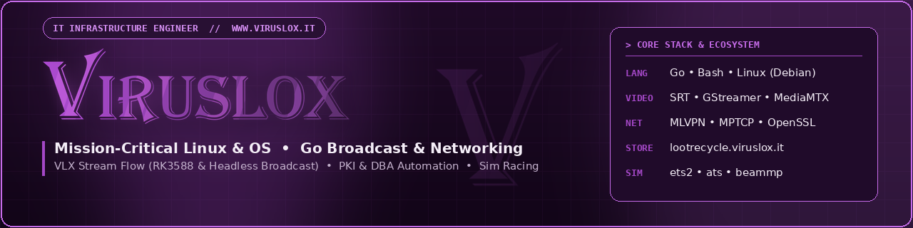

  

    

  
  
  
  
  

---

> *"IT professional, motorhead & gamer: From mission-critical operating systems to developing backend tools for streaming and networking."*

---

### `// VLX Stream Flow` — End-to-End Self-Hosted Broadcast & Telemetry Stack

Modular **Go & Linux** ecosystem taking live video, audio, and telemetry from field hardware to streaming platforms or monitoring centers ([architecture overview →](https://www.viruslox.it/vlx-stream-flow)):

| Tier | Repository | Role & Architecture |
| :--- | :--- | :--- |
| **Tier 01 • Edge & Transport** | [**`VLX_FrameFlow`**](https://github.com/viruslox/VLX_FrameFlow) | Turns **Rockchip RK3588** SBCs (Orange Pi 5 Plus, Radxa Rock 5T) + a VPS relay into a dual-protocol bonding unit (**MLVPN** UDP + **MPTCP/Shadowsocks** TCP), multi-camera **SRT** encoder, and real-time GPS tracker. |
| **Tier 02 • Composition** | [**`VLX_VisionBridge`**](https://github.com/viruslox/VLX_VisionBridge) | *"Headless OBS"* in Go for remote 24/7 Linux VMs: **DOM-dominant** Chromium scene rendering captured by a static passive **GStreamer** pipeline (`ximagesrc` on Xvfb `:99` + `pulsesrc`) into local **MediaMTX**. |
| **Tier 03 • Control & Audio** | [**`VLX_ChatBridge`**](https://github.com/viruslox/VLX_ChatBridge) | Unified Go command router handling **Twitch & YouTube** live events, self-hosted browser overlays/alerts, and a bi-directional **Discord Voice ↔ SRT** audio gateway. |

---

### `// Linux, PKI & DBA Automation` — The `SwissKnife` Suite & Creative Shell

| Project | Stack | Description |
| :--- | :--- | :--- |
| [**`PKI_SwissKnife`**](https://github.com/viruslox/PKI_SwissKnife) | `Bash` • `OpenSSL` | Streamlines Private Key Infrastructure (PKI) lifecycle: Certificate Authorities (CAs), signing workflows, and ready-to-deploy bundles for **Apache** & **Tomcat**. |
| [**`pgSQL_SwissKnife`**](https://github.com/viruslox/pgSQL_SwissKnife) | `Bash` • `PostgreSQL` | Administration, maintenance, backup automation, and security auditing suite for **PostgreSQL** clusters. |
| [**`MariaDB_SwissKnife`**](https://github.com/viruslox/MariaDB_SwissKnife) | `Bash` • `MariaDB/MySQL` | Administration, maintenance, and security auditing suite for **MariaDB / MySQL** database servers. |
| [**`Acid_Shell`**](https://github.com/viruslox/Acid_Shell) | `Bash` • `DSP / Video` | Pure Bash algorithmic sequencer for **8-bit Drum & Bass and Glitch** music paired with procedural mathematical video pattern generation. |

---

### `// Gaming, Sim Racing & Digital Platforms`

- **[LootRecycle (`lootrecycle.viruslox.it`)](https://lootrecycle.viruslox.it/)** — *Sustainable Digital Gaming*: giving unused wholesale Steam keys a second life (30%–70% off), built with **AES-256-GCM** key vault encryption, Steam OpenID, instant delivery, and zero tracking cookies ([project page →](https://www.viruslox.it/lootrecycle)).
- **VirusModLox (`VirusGearLox` Hyper-Performance Powertrain)** — Official high-speed convoy powertrain mod (Cummins N14+ GranTurismo 1,235 HP, CAT 3408 V8 SuperSport 3,200 HP, Paccar MX-13 Racing 6,400 HP / 15,000 Nm, 7-Speed SuperSport & 6-Speed Racing gearboxes + 5 custom air horns):
  - [**Steam Workshop — Euro Truck Simulator 2 (`id=3284117259`)**](https://steamcommunity.com/sharedfiles/filedetails/?id=3284117259) • Dedicated server: `ets2.viruslox.it`
  - [**Steam Workshop — American Truck Simulator (`id=3620907258`)**](https://steamcommunity.com/sharedfiles/filedetails/?id=3620907258) • Dedicated server: `ats.viruslox.it`
- **BeamNG.Drive (BeamMP)** — Multiplayer physics & motorhead server: `beammp.viruslox.it`

---

  <strong><a href="https://www.viruslox.it">www.viruslox.it</a></strong> — Online since September 21, 2004 • CopyLeft viruslox | Powered by Linux, OpenSource &amp; Caffè.

